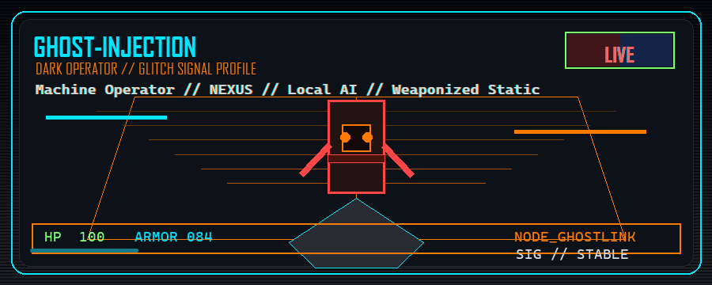

<div align="center">
  

  # ghost-injection

  **Security tooling, local AI systems, and operator interfaces — built to run on hardware I own.**
</div>

---

I build things that hold up when the network is hostile and the cloud is someone else's
computer: Android control planes over private tunnels, WiFi survey instruments,
single-file incident utilities, and a Telegram bot that runs its own models on a
Raspberry Pi.

## Shipped

| Repository | What it does |
|---|---|
| [**GhostLink**](https://github.com/ghost-injection/GhostLink) | Mirror and control Android from Windows over Tailscale. No USB, no port forwarding, no relay, no root. Native helper APK + themed scrcpy controller. |
| [**AegisWardrive**](https://github.com/ghost-injection/AegisWardrive) | Passive WiFi survey for Android: sweep, score, map, export KML/CSV. No root, no monitor mode — it reads what the OS already broadcasts. |
| [**reaper**](https://github.com/ghost-injection/creative-projects/tree/main/reaper) | Single-file process hunter for Windows and Linux. Find by name, port, or command line; kill the exact set with a dry run first. |
| [**pid-sniper**](https://github.com/ghost-injection/AI-Research-OffSec/tree/main/pid-sniper) | Click a window, get its PID, parent, path, and class. Plus a popup radar that logs new dialogs as they appear. |
| [**CipherShell Memory**](https://github.com/ghost-injection/CipherShell-Memory) | Private Obsidian vault used as durable memory for Codex, Hermes, Claude Code, and local model lanes. |

## Running, not published

`picobot-v2` — autonomous Telegram operator bot: local Ollama inference, twelve agent
roles, AES-256-GCM config vault, SQLite state, stdlib dashboard, three-tier SD imaging.
Private while it carries live credentials.

## How I build

```text
own the inference        → local models first, cloud only when it is the right tool
own the transport        → Tailscale or nothing; no vendor relay sees the screen
ship the smallest thing  → one file beats a deployment ceremony
state the limits         → a README that hides failure modes is marketing
```

## Stack

```text
python · java/kotlin · ts · rust · bash        sqlite · systemd · redis
ollama · llama.cpp · codex · claude code       android (adb, scrcpy, fgs)
raspberry pi 5 · rtx 5070 laptop · tailscale   nmap · rustscan · ghidra
```

## Contact

- GitHub: [@ghost-injection](https://github.com/ghost-injection)
- Email: `ghost.injection@proton.me`

<div align="center">
  <sub>hack the planet. keep the mask on.</sub>
</div>
